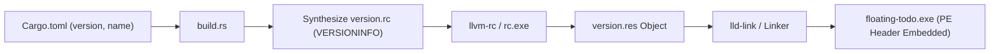

# App Publish Versioning & Release Guide

This document details how application versioning is embedded into the Windows Portable Executable (PE) binary, how to verify versions, and the end-to-end publishing workflow for **Floating TODO**.

---

## Table of Contents

- [Why Versioning Matters](#why-versioning-matters)
- [How Versioning is Embedded (Windows PE Resource)](#how-versioning-is-embedded-windows-pe-resource)
- [Checking the App Version](#checking-the-app-version)
  - [1. Command-Line Interface (`--version` / `-v`)](#1-command-line-interface---version---v)
  - [2. PowerShell File Version Query](#2-powershell-file-version-query)
  - [3. Windows File Explorer GUI](#3-windows-file-explorer-gui)
  - [4. In-App System Tray](#4-in-app-system-tray)
- [Publishing a New Release](#publishing-a-new-release)
  - [Step 1: Version Bump](#step-1-version-bump)
  - [Step 2: Rebuilding the Executable](#step-2-rebuilding-the-executable)
  - [Step 3: Creating a Git Release Tag](#step-3-creating-a-git-release-tag)
  - [Step 4: Automated CI/CD Release via GitHub Actions](#step-4-automated-cicd-release-via-github-actions)
- [Release Asset Checksums & Integrity](#release-asset-checksums--integrity)

---

## Why Versioning Matters

When publishing a native Windows desktop app, proper version metadata is critical for diagnosing crashes and error reports:

1. **Windows Event Viewer & Error Reporting (WER):** When a crash occurs, Windows records an Application Error (`Event ID: 1000`). If the binary lacks embedded Windows PE version metadata, Event Viewer reports the application version as `0.0.0.0` or empty. With embedded metadata, Event Viewer records the exact version (e.g. `0.2.3.0`), allowing developers to pinpoint which release failed.
2. **Crash Dump Analysis:** User-generated minidumps (`.dmp`) store module version headers. Having exact version metadata ensures symbol servers or local `.pdb` files match the crashed executable.
3. **User Bug Reports:** Users can check their installed version directly via the CLI, Explorer properties, or System Tray without needing developer tools.

---

## How Versioning is Embedded (Windows PE Resource)

Floating TODO uses a dedicated `build.rs` script that hooks into the Cargo build pipeline:



1. **Reads Package Manifest:** `build.rs` reads `version`, `name`, and `description` directly from `Cargo.toml` via `CARGO_PKG_VERSION`.
2. **Synthesizes Resource File:** It dynamically synthesizes a Windows Resource file (`version.rc`) containing a complete `VERSIONINFO` structure:
   - `FILEVERSION` & `PRODUCTVERSION` (e.g. `0,2,3,0`)
   - `FileVersion` & `ProductVersion` strings
   - `FileDescription`, `InternalName`, and `OriginalFilename`
3. **Compiles Resource:** It compiles the resource using `llvm-rc` (inside Docker) or `rc.exe` (on native Windows) into an object (`version.res`).
4. **Links PE Header:** It instructs the linker (`lld-link`) to embed `version.res` directly into the final Portable Executable (PE) headers.

---

## Checking the App Version

You can verify the published version through multiple methods:

### 1. Command-Line Interface (`--version` / `-v`)

Run the executable with the version flag from PowerShell or Command Prompt:

```powershell
.\floating-todo.exe --version
```

Output:
```text
Floating TODO v0.2.3
Architecture: x86_64-pc-windows-msvc
Edition: 2021
Config: %APPDATA%\FloatingTodo\tasks.json
Hotkeys: Ctrl+Shift+T (Toggle show/hide)
```
*(If run from outside a console, e.g. via Windows Run dialog `Win + R`, it opens an informational dialog box).*

### 2. PowerShell File Version Query

Query the embedded Windows PE header:

```powershell
(Get-Item .\floating-todo.exe).VersionInfo | Format-List FileVersion, ProductVersion, FileDescription
```

Output:
```text
FileVersion     : 0.2.3.0
ProductVersion  : 0.2.3
FileDescription : Ultra-lightweight floating TODO window for Windows
```

### 3. Windows File Explorer GUI

1. Right-click `floating-todo.exe` → Select **Properties**.
2. Navigate to the **Details** tab.
3. Inspect **File version**, **Product name**, and **Product version**.

### 4. In-App System Tray

- **Hover:** Hover your mouse over the system tray icon to view the tooltip: `Floating TODO v0.2.3`.
- **Right-Click:** The top header of the context menu explicitly displays the active version.

---

## Publishing a New Release

### Step 1: Version Bump

Increment the version number in `Cargo.toml` following [Semantic Versioning](https://semver.org/):

```toml
[package]
name = "floating-todo"
version = "0.2.4" # Bump version here
```

*(Alternatively, running `.\install.ps1 -Build` automatically increments the patch version in `Cargo.toml`).*

### Step 2: Rebuilding the Executable

Build the new binary with embedded PE metadata:

```powershell
# Using the automated Docker script (Recommended)
.\build.ps1

# Or using native Cargo
cargo build --release
```

### Step 3: Creating a Git Release Tag

Commit the updated manifest and create an annotated git tag matching the version pattern `v*`:

```powershell
git add Cargo.toml Cargo.lock
git commit -m "Release v0.2.4"
git tag -a v0.2.4 -m "Release v0.2.4"
git push origin main --tags
```

### Step 4: Automated CI/CD Release via GitHub Actions

The repository includes a release automation workflow defined in `.github/workflows/release.yml`:

- **Trigger:** Automatically runs whenever a tag matching `v*` is pushed to GitHub, or via manual trigger (`workflow_dispatch`).
- **Build Pipeline:**
  1. Spins up a `windows-latest` runner.
  2. Sets up the stable Rust toolchain for target `x86_64-pc-windows-msvc`.
  3. Executes `cargo test` unit tests.
  4. Compiles the optimized release binary with embedded PE version headers.
  5. Packages the executable as `floating-todo-vX.Y.Z.exe`.
  6. Computes SHA-256 cryptographic checksums.
  7. Publishes a new GitHub Release with attached binaries and auto-generated release notes.

---

## Release Asset Checksums & Integrity

Every automated release generates an accompanying SHA-256 checksum file (`floating-todo-vX.Y.Z.exe.sha256`).

To verify the integrity of a downloaded release binary locally:

```powershell
# Verify SHA256 checksum
(Get-FileHash -Path .\floating-todo.exe -Algorithm SHA256).Hash
```
Compare the resulting hash with the hash published on the GitHub Releases page.
